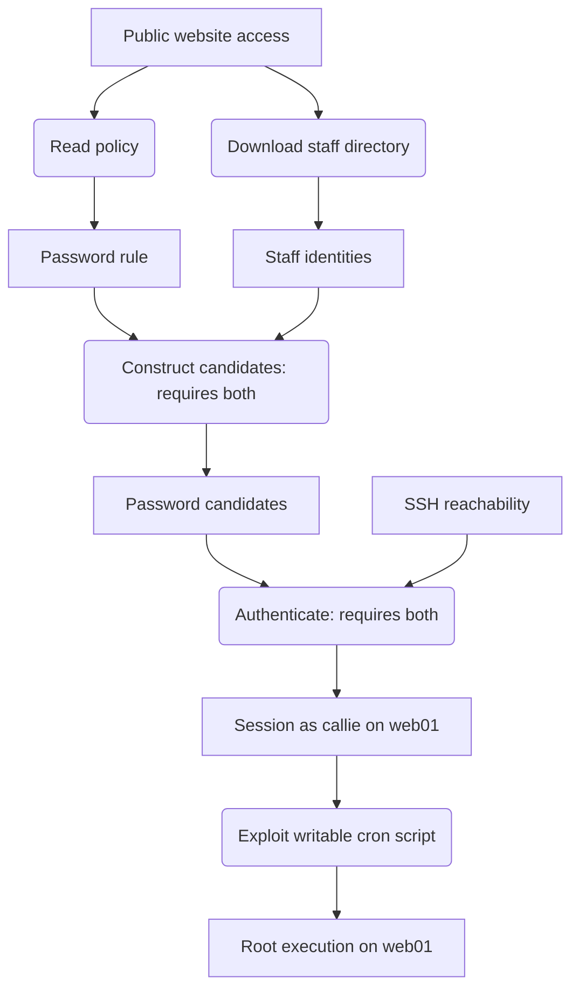
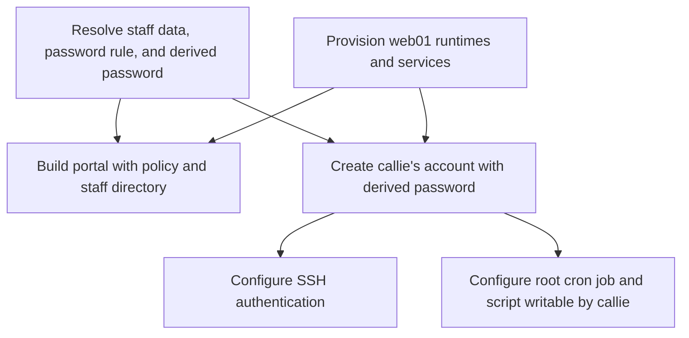

# Loot-based scenario model: architecture plan

Status: proposal; no runtime changes implemented.

## Motivation

The current [entity graph](entity_graph_model.md) combines construction
dependencies and attacker progression, folding knowledge acquisition into larger
exploits. [Issue #13](https://github.com/Akshay-Rohatgi/GameOfEverything/issues/13)
highlights missing endpoint discoveries, password rules, and scored observations.

Make progression depend on accumulated loot, while preserving consistent value
handoffs between builders. Support independent branches, combined prerequisites,
and alternative solutions.

## Major architectural changes

Use one authoritative scenario specification with two derived graph views:

| View | Nodes | Meaning of an arrow |
|---|---|---|
| **Construction graph** | Build tasks: components, platform provisioning, and shared-value resolution. | The source task must supply a resource or value before the destination task can run. |
| **Progression graph** | Loot definitions and actor actions. | Loot → action declares a requirement; action → loot declares a possible reward. |

The construction graph determines how to assemble the environment. Its
dependencies form a DAG. Components are applications, configuration modules, or
planted artifacts with explicit resource ownership.

The progression graph represents possible changes in actor state. An actor can
perform an action when its AND/OR requirements are satisfied, then gains loot
only after the action succeeds. Inventory persists across branches; the actor
does not need to occupy a single current node. Physical network topology remains
in the world definitions.

Requirements reference scoped loot, such as a session as `callie` on `web01`,
rather than a particular producer. Multiple actions can grant equivalent loot.
AND/OR semantics are explicit in `ActionSpec`; arrows alone do not distinguish
them.

One component can support several actions; one action can involve several
components. Actor-side decoding or password derivation needs no deployment
component.

### Proposed classes

| Class | Responsibility |
|---|---|
| `ScenarioSpec` | Aggregate definitions, initial inventory, and the other specs. |
| `System` | Retain machine, OS, service, and network definitions. |
| `WorldObject` | Accounts, files, endpoints, permissions, and resource ownership. |
| `SharedValue` | Authoritative literal, generated, or derived values. |
| `ComponentSpec` | Resource ownership, consumed definitions, and implementation constraints. |
| `LootSpec` | Obtainable knowledge, artifacts, credentials, or capabilities; identity and scope. |
| `ActionSpec` | AND/OR requirements, rewards, and implementation bindings or actor-side operations. |
| `ObjectiveSpec` | Evidence-backed success conditions and optional points. |
| `BuildPlan` | Derived construction tasks and dependencies. |
| `ActorState` | Acquired values and capabilities with acquisition evidence. |

Retain `BuildArtifact` and `Procedure`. Procedure outputs provide acquisition
evidence. Track build completion separately from actor progression.

## Planning and execution workflow

1. **Objectives and starting conditions:** establish the outcome and initial access.
2. **World and component outlines:** assign references, ownership, and shared values.
3. **Loot catalog:** declare possible acquisitions without granting them.
4. **Action fragments:** reference existing definitions; explicitly revise missing
   definitions before accepting an action.
5. **Construction contracts:** resolve values and interfaces, validate ownership,
   and derive `BuildPlan`. Publish builder-selected values before dependent tasks.
6. **Build, validate, package:** deploy components, replay actions, and export artifacts.

Avoid independent LLM generation of every spec. Give models bounded planning
tasks grounded in supported atoms and runtimes. Code handles references, shared
values, dependency derivation, and contract validation.

## Example

The exercise is to discover a staff password rule, obtain staff identities,
derive candidates, authenticate as `callie`, and exploit a writable cron script.

### Progression graph

Rectangles are loot; rounded nodes are actions. Public website access and SSH
reachability are initial inventory. Other rectangles describe possible rewards,
not facts the actor already knows.

The actor can read the policy and download the directory in either order, but
needs both outputs to derive candidates. Authentication also needs SSH
reachability. The cron component explicitly grants `callie` write permission to
the script invoked by root; this action is specific to that configuration.
Another credential source could enable authentication without the policy branch.

### Construction graph

These nodes are construction tasks. Arrows specify prerequisites, not attacker
movement. Shared definitions are resolved once and passed to their consumers.

One portal component supports both discovery actions. Account and SSH components
support authentication; the cron component supports privilege escalation.
Password derivation happens on the actor's machine and has no deployment task.

Both graphs reference the same staff data and rule. The builder computes the
installed password before deployment; the actor independently discovers the
inputs and derives candidates during execution. Completing these build tasks
does not grant the actor any loot.

## Validation and implementation priorities

- **Static validation:** check references, scopes, ownership, supported mechanisms,
  bindings, and value dependencies. Evaluate AND/OR requirements to establish
  modeled objective reachability from initial inventory.
- **Execution validation:** verify world consistency and grant loot only after
  successful operations. Builders and validators have expected answers;
  acquisition procedures use live captured values.
- **Requirement semantics:** distinguish technical restrictions from knowledge
  used by an intended technique. An undiscovered endpoint can still be guessed;
  the model must not invent a restriction absent from the deployed world.
- **First milestone:** one actor, accumulating loot, shared values, and the example
  fixture. Verify discovery order, provenance, and missing inputs; then add an
  alternative credential source and adapt packaging and checkpoints.
- **Evidence before expansion:** measure repairs and end-to-end pass rates.
  Schemas alone do not establish reliability. Defer expiring sessions, consumed
  loot, and broader mutable world state.
